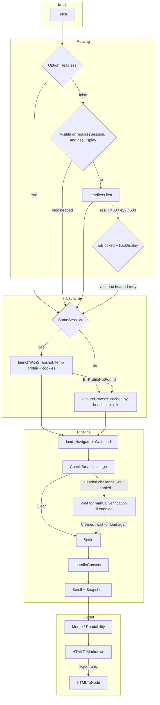

# Architecture

go-browser is four modules: routing picks a browser, the browser loads the page, the page becomes snapshots, the snapshots become output; the only loop back is one headed retry when blocked.

## System overview

## Layers

| Layer | File | Responsibility | Exported |
|---|---|---|---|
| Entry and routing | `core/fetch.go` | Mode selection, blocked detection, retry decision, load pipeline | `Fetch`, `Option`, `Viewport`, `Result`, `Error`, `TypeMarkdown`, `TypeHTML`, `TypeJSON` |
| Manual verification | `core/challenge.go` | Detects a challenge before extraction and waits for the user in the same headed tab when enabled | `ErrChallengeRequired`, `ErrChallenge` |
| Browser lifecycle | `core/launcher.go` | Instance cache, idle eviction, concurrency gate, temp-profile launch | `Close`, `SetMaxConcurrency`, `Browser`, `DefaultUserAgent`, `ErrProfileNotFound` |
| Cookie decryption | `core/cookie.go` (macOS / Linux), `core/cookieUnsupport.go` (stub that returns an error; unreachable in practice because `SameSession` falls back to a regular browser on other platforms before reaching it) | Per-platform key resolution (macOS Keychain, Linux `peanuts`/keyring), PBKDF2, `v10`/`v11` AES-CBC decryption, CDP cookie assembly | none (internal) |
| Content processing | `core/markdown.go` | Snapshot merge, time inlining, Markdown and tree output, deduplication | `Merge`, `HTMLToMarkdown`, `HTMLToNode`, `DedupTree`, `DedupMarkdownParagraphs`, `InlineTimeElements`, `Node` |

Chrome is driven through [go-rod](https://github.com/go-rod/rod) over the Chrome DevTools Protocol. go-rod and chromedp are CDP drivers that you script step by step; go-browser wraps navigation, settling, consent handling, scrolling and conversion into one `Fetch` call.

For content conversion, [JohannesKaufmann/html-to-markdown](https://github.com/JohannesKaufmann/html-to-markdown) converts HTML you already hold; go-browser renders the page in Chrome first, extracts the main content with go-readability, and converts it with its own `HTMLToMarkdown` built on `golang.org/x/net/html`. [playwright-go](https://github.com/mxschmitt/playwright-go) is a browser automation library for Chromium, Firefox and WebKit, and [geziyor](https://github.com/geziyor/geziyor) is a crawling and scraping framework with JS rendering; go-browser drives Chrome only and returns one page per `Fetch` call. [Anakin](https://github.com/Anakin-Inc/anakin) is a self-hosted web scraping API service that returns Markdown or JSON; go-browser is a library imported directly into your Go program.

The three injected scripts are embedded from `core/embed/` with `go:embed`: `stealth.js` for anti-detection, `listener.js` for load settling, `consent.js` for consent banners.

## Used by Agenvoy

go-browser is the web layer of [Agenvoy](https://agenvoy.com/), a local AI agent written in Go: its `fetch_page`, `download_file` and `search_web` tools call `Fetch`. See [How Agenvoy Uses go-browser](/agenvoy) for each tool's options and what Agenvoy does with the result.

## Cross-cutting rules

| Rule | Implementation |
|---|---|
| Context flows through | The ctx given to `Fetch` reaches settling, consent evaluation and scroll waits; `timeout` wraps it in a child context |
| Concurrency gated by a semaphore | `acquireSem` must grant a slot before a page is created, and `load` releases it on return |
| Resource release is paired | `launchWithSnapshot` returns a cleanup that closes the browser and removes the temp directory; cached instances are reclaimed by the evictor or `Close` |
| Degradation does not abort | A missing Chrome profile returns `ErrProfileNotFound`, and `fetchWith` continues on a regular browser |
| Failures stay distinguishable | Site blocks return `*Error{Status}`, extraction failures return a plain error, and routing treats them differently |

## Further reading

The module-level expansion — per-module diagrams, sequences and state machines — lives in [doc/architecture.md](https://github.com/pardnchiu/go-browser/blob/master/doc/architecture.md) in the repository. For the detail of any single flow, see [Core Concepts](/core-concepts).
