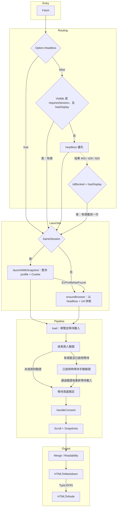

# 架構

go-browser 由四個模組構成：路由決定用哪個瀏覽器，瀏覽器載入頁面，頁面轉成快照，快照轉成輸出；唯一的回頭路是被擋時的一次有頭重試。

## 系統概覽

## 分層

| 層 | 檔案 | 職責 | 對外 |
|---|---|---|---|
| 進入點與路由 | `core/fetch.go` | 模式選擇、被擋判定、重試決策、載入管線 | `Fetch`、`Option`、`Viewport`、`Result`、`Error`、`TypeMarkdown`、`TypeHTML`、`TypeJSON` |
| 手動驗證 | `core/challenge.go` | 擷取前偵測驗證，啟用等待後在同一個有視窗的分頁等待使用者完成 | `ErrChallengeRequired`、`ErrChallenge` |
| 瀏覽器生命週期 | `core/launcher.go` | 實例快取、閒置回收、併發閘、暫存 profile 啟動 | `Close`、`SetMaxConcurrency`、`Browser`、`DefaultUserAgent`、`ErrProfileNotFound` |
| Cookie 解密 | `core/cookie.go`（macOS／Linux）、`core/cookieUnsupport.go`（回傳錯誤的 stub；實務上走不到，其他平台在此之前就已退回一般瀏覽器） | 依平台解析金鑰（macOS Keychain、Linux `peanuts`／keyring）、PBKDF2、`v10`／`v11` AES-CBC 解密、組 CDP cookie | 無（內部） |
| 內容處理 | `core/markdown.go` | 快照合併、時間元素內聯、Markdown 與樹狀輸出、去重 | `Merge`、`HTMLToMarkdown`、`HTMLToNode`、`DedupTree`、`DedupMarkdownParagraphs`、`InlineTimeElements`、`Node` |

Chrome 透過 [go-rod](https://github.com/go-rod/rod) 以 Chrome DevTools Protocol 驅動。go-rod 與 chromedp 是需要逐步撰寫流程的 CDP 驅動程式；go-browser 把導覽、等待穩定、同意橫幅處理、捲動與轉換包成一次 `Fetch` 呼叫。

內容轉換方面，[JohannesKaufmann/html-to-markdown](https://github.com/JohannesKaufmann/html-to-markdown) 轉換你手上已有的 HTML；go-browser 先以 Chrome 渲染頁面、用 go-readability 擷取主要內容，再以自身基於 `golang.org/x/net/html` 的 `HTMLToMarkdown` 轉換。[playwright-go](https://github.com/mxschmitt/playwright-go) 是控制 Chromium、Firefox、WebKit 的瀏覽器自動化函式庫，[geziyor](https://github.com/geziyor/geziyor) 是支援 JS 渲染的爬蟲框架；go-browser 只驅動 Chrome，每次 `Fetch` 回傳一個頁面。[Anakin](https://github.com/Anakin-Inc/anakin) 是自架的網頁擷取 API 服務，回傳 Markdown 或 JSON；go-browser 則是直接匯入 Go 程式的函式庫。

注入頁面的三支腳本以 `go:embed` 內嵌於 `core/embed/`：`stealth.js`（反偵測）、`listener.js`（載入完成判定）、`consent.js`（同意橫幅）。

## Agenvoy 中的用法

go-browser 是 [Agenvoy](https://agenvoy.com/zh/) 的網頁存取層；Agenvoy 是以 Go 撰寫、跑在你電腦上的本地 AI agent，它的 `fetch_page`、`download_file`、`search_web` 工具都呼叫 `Fetch`。各工具傳入的選項與 Agenvoy 如何處理結果，見 [Agenvoy 如何使用 go-browser](/zh/agenvoy)。

## 跨切原則

| 原則 | 實作 |
|---|---|
| Context 全程傳遞 | `Fetch` 的 ctx 傳到 settle、consent eval 與捲動等待；逾時由 `timeout` 參數包成子 context |
| 併發由 semaphore 控制 | `acquireSem` 取得名額後才建立 page，`load` 結束即釋放 |
| 資源釋放成對 | `launchWithSnapshot` 回傳 cleanup 關閉瀏覽器並刪暫存目錄；快取實例由 evictor 或 `Close` 回收 |
| 降級不中斷 | 找不到 Chrome 設定檔時回 `ErrProfileNotFound`，由 `fetchWith` 改走一般瀏覽器 |
| 失敗可辨識 | 站點封鎖回 `*Error{Status}`，萃取失敗回一般 error；兩者在路由層意義不同 |

## 延伸閱讀

模組級的完整展開（各模組流程圖、sequence、狀態機）在 repo 的 [doc/architecture.zh.md](https://github.com/pardnchiu/go-browser/blob/master/doc/architecture.zh.md)。單一流程的細節請看 [核心概念](/zh/core-concepts)。
