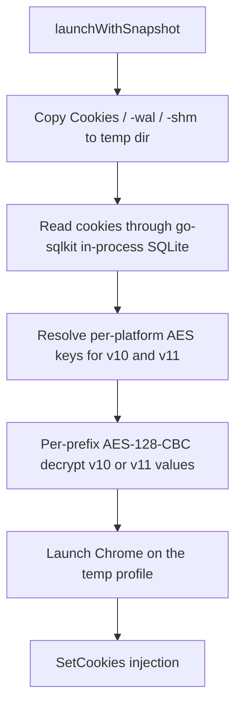

# Cookie Sessions

How `SameSession` reads pages behind a login by decrypting cookies from your local Chrome profile and injecting them into a throwaway browser.

## Usage

```go
result, err := browser.Fetch(ctx, "https://example.com/profile", 60*time.Second, &browser.Option{
	SameSession: true,
	Profile:     "Default",
})
```

Your own Chrome is never touched: the cookie database is copied to a temporary directory and read from there, and the page loads in a fresh Chrome on an empty temporary profile with the decrypted cookies injected over CDP. `Profile` names a subdirectory of the Chrome profile root (`Default`, `Profile 1`, ...).

## Flow



## Key resolution

The AES key depends on the platform and on the cookie's version prefix. The cookie database itself is read in-process through `go-sqlkit`, so no `sqlite3` binary is required.

| Prefix | Platform | Key source | PBKDF2 iterations |
|---|---|---|---|
| `v10` | macOS | Keychain password: `security find-generic-password -w -s "Chrome Safe Storage" -a Chrome` | 1003 |
| `v10` | Linux | Fixed password `peanuts` (basic mode, no keyring) | 1 |
| `v11` | Linux | Keyring password (see below) | 1 |

On Linux the `v11` password is looked up in both keyrings concurrently and the results are de-duplicated:

| Keyring | Command |
|---|---|
| gnome-keyring (GNOME/MATE/XFCE/Unity) | `secret-tool lookup application chrome`, then `application chromium` |
| KWallet (KDE) | `kwallet-query kdewallet -f "Chrome Keys" -r "Chrome Safe Storage"`, then the `Chromium` pair |

When several candidate passwords exist, the correct one is selected by decrypting a sample `v11` cookie and checking that the first 32 bytes of the plaintext equal `SHA-256(host_key)` — the domain-hash prefix Chrome binds to each value. Matching this 32-byte hash is effectively unambiguous, so a wrong candidate is never accepted.

## Decryption and injection

| Item | Value |
|---|---|
| Key derivation | PBKDF2-SHA1, salt `saltysalt`, 16-byte key, iterations per the table above |
| Cipher | AES-128-CBC, IV of 16 space characters, PKCS#7 padding |
| Version marker | 3-byte prefix `v10` / `v11` selects the key; a prefix with no matching key is used as stored |
| Plaintext prefix | The first 32 bytes after decryption are the `SHA-256(host_key)` domain hash and are stripped whenever the plaintext is at least 32 bytes long, so empty-value cookies decrypt to an empty string instead of surfacing the hash |

Each row of the `cookies` table becomes a CDP cookie with domain, path, expiry (converted from the WebKit epoch), `Secure`, `HTTPOnly` and `SameSite`. Rows whose padding is invalid under the chosen key are treated as a wrong key and skipped.

### Injection

Cookies without a domain or name are dropped, and an empty path becomes `/`. If the batch injection fails, cookies are injected one by one and the run continues as long as at least one lands; zero successes returns `inject cookies (0/N)`.

## Failure behavior

| Situation | Result |
|---|---|
| Profile root unknown (not macOS/Linux) or `Profile` directory missing | Falls back to a regular cached browser without cookies |
| Keychain lookup, keyring lookup (no gnome-keyring/KWallet password), cookie database read or launch failure | The error is returned; no fallback |
| Session ends | Browser closed and temporary directory removed, even on error |

Routing still applies: a `SameSession` call can be retried headed when blocked, and each attempt builds its own temporary profile. See [Fetch Routing](/core-concepts-routing).
