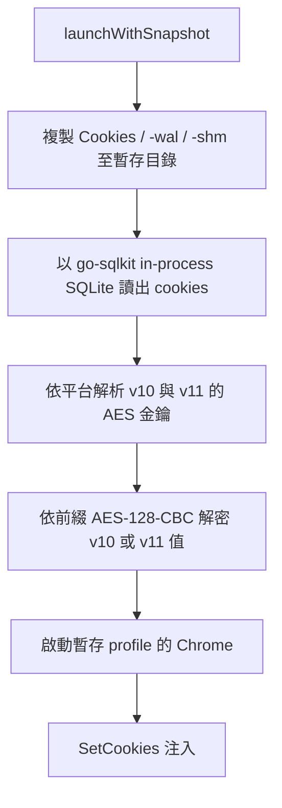

# Cookie 工作階段

`SameSession` 如何解密本機 Chrome 設定檔的 Cookie 並注入一次性瀏覽器，以讀取需登入的頁面。

## 用法

```go
result, err := browser.Fetch(ctx, "https://example.com/profile", 60*time.Second, &browser.Option{
	SameSession: true,
	Profile:     "Default",
})
```

原本的 Chrome 完全不受影響：Cookie 資料庫先複製到暫存目錄再從副本讀取，頁面則由一個使用空白暫存設定檔的新 Chrome 載入，解密後的 Cookie 經 CDP 注入。`Profile` 是 Chrome 設定檔根目錄下的子目錄名（`Default`、`Profile 1`……）。

## 流程



## 金鑰解析

AES 金鑰取決於平台與 Cookie 的版本前綴。Cookie 資料庫本身改以 `go-sqlkit` in-process 讀取，不再需要 `sqlite3` 執行檔。

| 前綴 | 平台 | 金鑰來源 | PBKDF2 迭代 |
|---|---|---|---|
| `v10` | macOS | Keychain 密碼：`security find-generic-password -w -s "Chrome Safe Storage" -a Chrome` | 1003 |
| `v10` | Linux | 固定密碼 `peanuts`（無 keyring 的 basic 模式） | 1 |
| `v11` | Linux | keyring 密碼（見下） | 1 |

Linux 的 `v11` 密碼會同時並行查詢兩種 keyring，結果去重：

| keyring | 指令 |
|---|---|
| gnome-keyring（GNOME／MATE／XFCE／Unity） | `secret-tool lookup application chrome`，再試 `application chromium` |
| KWallet（KDE） | `kwallet-query kdewallet -f "Chrome Keys" -r "Chrome Safe Storage"`，再試 `Chromium` 那組 |

有多個候選密碼時，以一筆 `v11` 樣本解密後比對「明文前 32 bytes 是否等於 `SHA-256(host_key)`」挑出正確的——這是 Chrome 綁在每筆值前面的 domain-hash 前綴。比對這 32 bytes 幾乎不可能誤判，錯誤候選不會被採用。

## 解密與注入

| 項目 | 值 |
|---|---|
| 金鑰推導 | PBKDF2-SHA1，salt `saltysalt`，16 bytes 金鑰，迭代次數依上表 |
| 加密演算法 | AES-128-CBC，IV 為 16 個空白字元，PKCS#7 padding |
| 版本標記 | 3 bytes 前綴 `v10` / `v11` 決定用哪把金鑰；前綴無對應金鑰者直接當原值使用 |
| 明文前綴 | 解密後前 32 bytes 是 `SHA-256(host_key)` domain hash，只要明文長度達 32 bytes 就裁剪掉，使空值 Cookie 解出空字串而非把 hash 當成內容 |

`cookies` 資料表每一列轉成一筆 CDP cookie，含 domain、path、到期時間（由 WebKit epoch 換算）、`Secure`、`HTTPOnly`、`SameSite`。在所選金鑰下 padding 不合法的列視為金鑰錯誤而略過。

### 注入

缺 domain 或 name 的 Cookie 會被丟棄，空 path 補成 `/`。批次注入失敗時改逐筆注入，只要有一筆成功就繼續；全部失敗回傳 `inject cookies (0/N)`。

## 失敗行為

| 情況 | 結果 |
|---|---|
| 無法判定設定檔根目錄（非 macOS／Linux）或 `Profile` 目錄不存在 | 改用不帶 Cookie 的一般快取瀏覽器 |
| Keychain 查詢、keyring 查詢（無 gnome-keyring／KWallet 密碼）、Cookie 資料庫讀取或啟動失敗 | 直接回傳錯誤，不降級 |
| 工作階段結束 | 關閉瀏覽器並刪除暫存目錄，出錯時也一樣 |

路由仍然適用：`SameSession` 呼叫被擋時可以有頭重試，每次嘗試各自建立暫存設定檔。見 [Fetch 路由](/zh/core-concepts-routing)。
