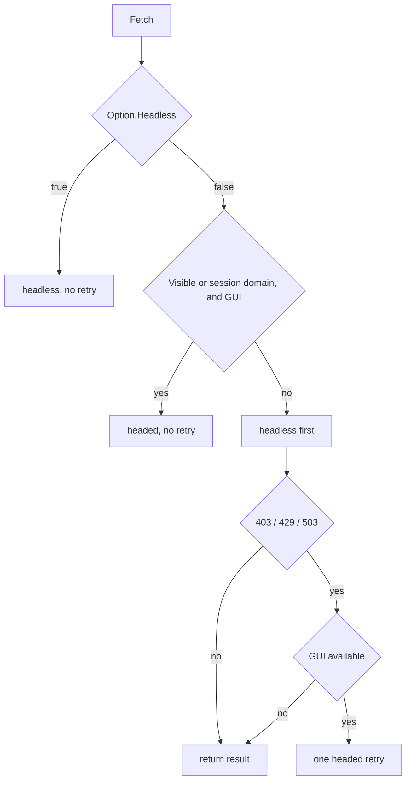

# Fetch Routing

How `Fetch` chooses between a headless and a headed browser, and the only case in which it tries twice.

## Decision flow

| Branch | Condition | Attempts |
|---|---|---|
| Forced headless | `Option.Headless` is true | 1, headless |
| Visible or session domain | `Option.Visible` is true or the host is on the session list, and a GUI is available | 1, headed |
| Default | Everything else | Headless, then one headed retry only when blocked |

## What counts as blocked

Only three status codes: `403`, `429`, `503`, read either from an `*Error` or from `Result.Status`. `404`, `204` and `no article extracted` do **not** trigger a retry, because they mean the page is missing or extraction failed, and a different browser mode changes neither. Errors that are not `*Error` (launch failures, timeouts) are returned without a retry.

After the initial page load and before extraction, `Fetch` checks for a challenge regardless of output format. A detected challenge in headless mode returns a `*Error` with status `403`, which triggers one headed retry in the default route if a GUI is available.

## Session domains

Social and community sites that rarely render useful content headless go straight to a headed browser when a GUI exists. The list is embedded from `core/embed/session_domains.json`, and a host matches when it equals an entry or ends with `.` plus the entry:

`facebook.com`, `fb.com`, `fb.watch`, `twitter.com`, `x.com`, `instagram.com`, `linkedin.com`, `threads.net`, `tiktok.com`, `pinterest.com`, `snapchat.com`, `weibo.com`, `weibo.cn`, `xiaohongshu.com`, `xhs.link`, `douyin.com`, `bilibili.com`, `zhihu.com`, `discord.com`, `telegram.org`, `t.me`, `vk.com`, `quora.com`

Without a GUI these hosts follow the default branch.

## Visible

`Option.Visible: true` sends any host down the same headed branch as a session domain: one headed attempt, no retry, provided a GUI is available. Without a GUI it falls back to the default headless-first branch, and `Option.Headless: true` takes precedence over it.

## GUI detection

`hasDisplay()` is always true on macOS; on Linux it is true when `DISPLAY` or `WAYLAND_DISPLAY` is non-empty. Containers and headless servers therefore never attempt to launch a headed browser. Headed windows are placed at `-32000,-32000`, off screen.

## Manual verification

If a challenge is detected in headed mode and `ChallengeWait <= 0`, `Fetch` immediately returns `ErrChallengeRequired`. A positive value keeps the same tab open for the user to complete verification. If the challenge persists for about five seconds, the library attempts to bring the browser window forward. Loading and extraction resume once the challenge clears.

The wait has its own limit, separate from the page load `timeout`, and still respects the caller’s context cancellation or deadline. When the wait expires, `Fetch` returns `ErrChallenge`. `ChallengeWait` does not change browser routing: forced headless mode and hosts without a GUI cannot wait for interaction.
