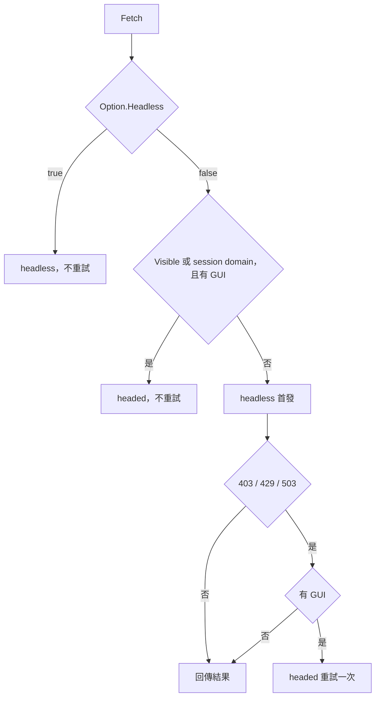

# Fetch 路由

`Fetch` 如何在 headless 與有頭瀏覽器之間選擇，以及唯一會嘗試兩次的情況。

## 決策流程

| 分支 | 條件 | 嘗試次數 |
|---|---|---|
| 強制 headless | `Option.Headless` 為 true | 1 次，headless |
| Visible 或 Session 網域 | `Option.Visible` 為 true 或主機在 session 清單內，且有 GUI | 1 次，有頭 |
| 預設 | 其他情況 | 先 headless，僅被擋時以有頭重試一次 |

## 什麼算被擋

只有三個狀態碼：`403`、`429`、`503`，來源可以是 `*Error` 也可以是 `Result.Status`。`404`、`204`、`no article extracted` 都**不**觸發重試——那些是頁面不存在或萃取失敗，換一種瀏覽器模式不會改變結果。非 `*Error` 的錯誤（啟動失敗、逾時）直接回傳，不重試。

頁面初次載入後、擷取前會偵測真人驗證，不受輸出格式限制。無頭模式偵測到驗證會回傳狀態為 `403` 的 `*Error`；一般路由在有 GUI 時會以有頭模式重試一次。

## Session 網域

headless 下鮮少能渲染出有效內容的社群網站，在有 GUI 時直接走有頭瀏覽器。清單內嵌於 `core/embed/session_domains.json`，主機等於清單項目或以 `.` 加項目結尾即命中：

`facebook.com`、`fb.com`、`fb.watch`、`twitter.com`、`x.com`、`instagram.com`、`linkedin.com`、`threads.net`、`tiktok.com`、`pinterest.com`、`snapchat.com`、`weibo.com`、`weibo.cn`、`xiaohongshu.com`、`xhs.link`、`douyin.com`、`bilibili.com`、`zhihu.com`、`discord.com`、`telegram.org`、`t.me`、`vk.com`、`quora.com`

沒有 GUI 時這些主機走預設分支。

## Visible

`Option.Visible: true` 讓任何主機走與 session 網域相同的有頭分支：有 GUI 時有頭嘗試一次、不重試。沒有 GUI 時退回預設的 headless 優先分支；`Option.Headless: true` 優先於它。

## GUI 判定

`hasDisplay()` 在 macOS 恆為真；Linux 上 `DISPLAY` 或 `WAYLAND_DISPLAY` 非空即為真。容器與無桌面的伺服器因此永遠不會嘗試啟動有頭瀏覽器。有頭視窗放在 `-32000,-32000`，位於螢幕外。

## 真人驗證

有頭模式偵測到驗證時，`ChallengeWait <= 0` 會立即回傳 `ErrChallengeRequired`。設定正值後，瀏覽器保留同一分頁，讓使用者手動完成驗證；若驗證持續存在約 5 秒，程式會嘗試將視窗帶到前景。偵測到驗證消失後會繼續載入及擷取。

等待使用獨立於每次頁面載入 `timeout` 的時間上限，但仍受傳入的 `context.Context` 取消或截止時間約束；等待用盡時回傳 `ErrChallenge`。`ChallengeWait` 不會變更瀏覽器路由，強制無頭或沒有 GUI 時無法進行互動。
